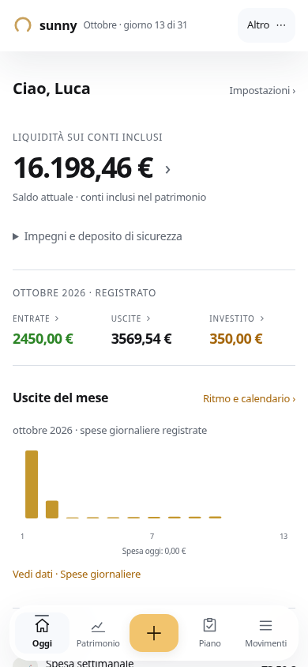
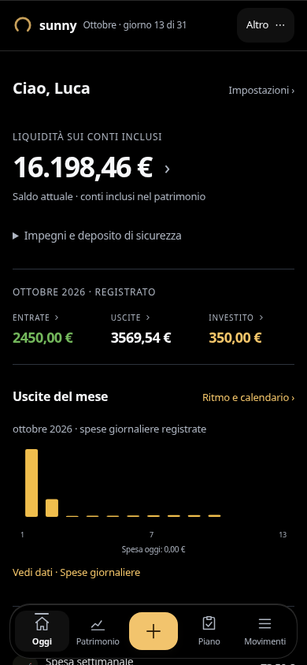
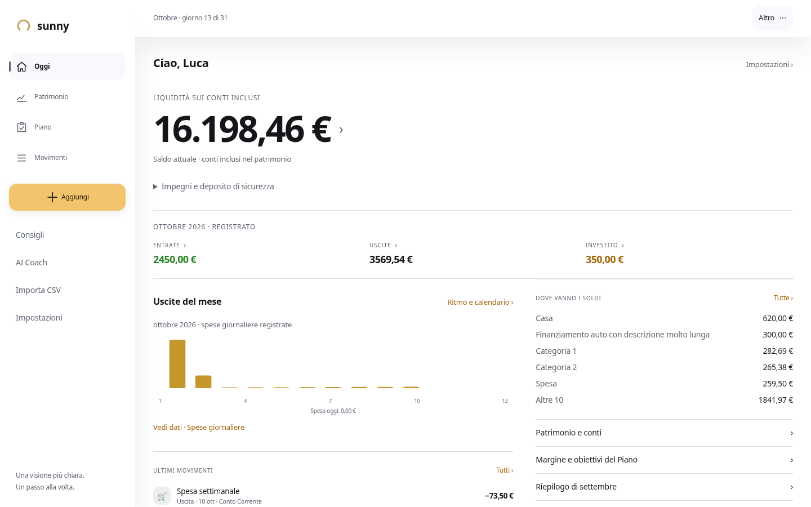
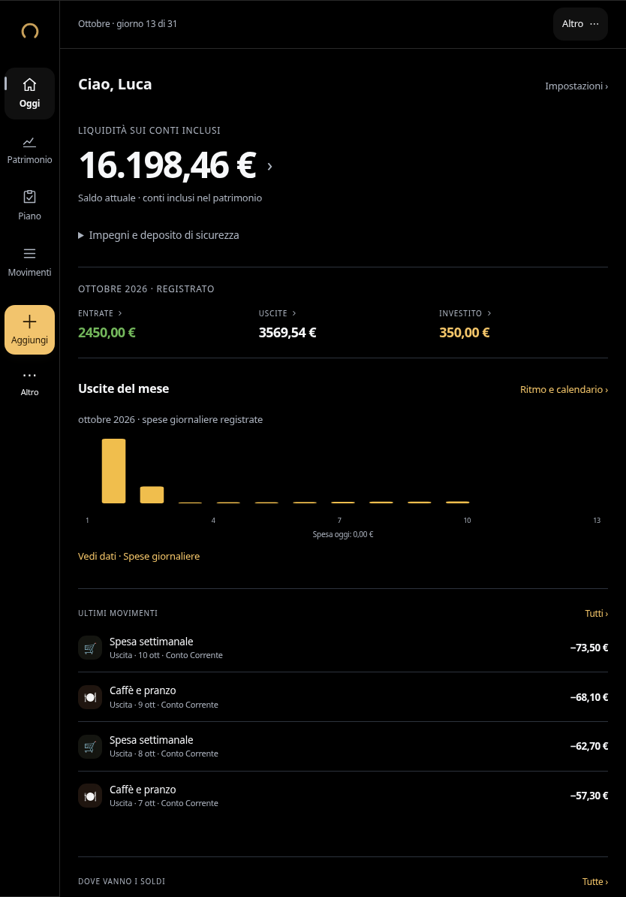
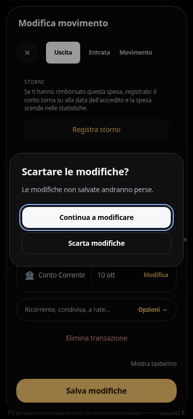
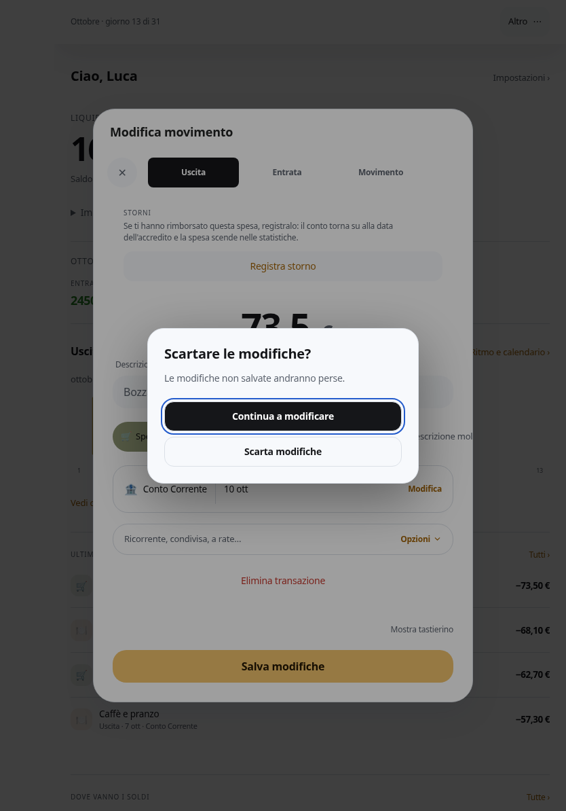

# Revisione UI3 — esiti del 13 ottobre 2026

Branch `feat/ui3-reference-revision`, base main `c73a44a`. Specifica #145 importata integralmente nel documento 06. PR di implementazione separata: nessun merge o deploy. Resolver, allowlist Luca e autorizzazioni invariati.

## Risultato

Oggi privilegia il saldo dei conti inclusi, con periodo e perimetro espliciti. Liquidità libera, impegni e deposito restano disponibili nel dettaglio; non sono confusi con il margine del Piano. Righe e divisori sostituiscono la frammentazione in pannelli. Bianco pieno/nero puro; glass limitato a navigazione e livelli temporanei.

Sintesi mensile, spese giornaliere registrate, cinque categorie più Altre e movimenti recenti anche su mobile. Le priorità compaiono solo in presenza di pagamenti, rischi o scadenze: più elementi hanno un riepilogo espandibile con accesso a tutte le fonti. Il grafico apre i movimenti del giorno anche con Enter/Spazio. I movimenti recenti aprono l'editor esistente.

Patrimonio e Impegni esplicitano il significato dei totali; il Piano aggiunge una barra derivata dai selettori esistenti senza cambiare formule, margine negativo o motore. Impostazioni raggruppate, Impegni stabile nel menu e ritorni con origine/fallback. Le analisi aperte dal riepilogo corrente usano il mese e i conti coerenti con quel numero, preservando i precedenti filtri della consultazione indipendente.

L'editor conserva ordine, emoji, storni, rate, ricorrenze e campi condizionali. La conferma di scarto resta sovrapposta al form montato: verificati geometria, bozza e focus. Nessuna modifica alle sorgenti Wrapped o alla configurazione di rollout.

## Verifiche eseguite

| Verifica | Esito reale |
|---|---|
| TypeScript `npx tsc --noEmit` | PASS |
| Unit test, TZ UTC | 834 passati, 5 saltati; 68 file passati, 1 saltato |
| Build produzione | PASS |
| Matrice UI3: 19 rotte × 2 temi × 390/834/1440 px | 114 aperture, zero errori JavaScript e zero overflow |
| Verticale Oggi → saldo → editor → scarto → calendario → Impegni | 6 combinazioni PASS; 390×844, 834×1194, 1440×900 |
| Stress 320×568, testo 200%, vuoto/categorie e importi estremi | 32 casi PASS nei due temi |
| Periodi/perimetri, priorità multiple e grafico da tastiera | PASS nei due temi |
| Suite browser di moduli, grafici, import, onboarding, dismiss, Piano e interazioni | 22/23 PASS nel giro completo; accessibilità corretta e rieseguita PASS |
| Accessibilità dopo correzione | Contrasto campionato ≥4.5:1, 40 Tab nel dialog, focus errore, reduced motion, footer a 500 px, testo 200%, target primari ≥44 px: PASS |
| Wrapped | 24 immagini stories/riepilogo/obiettivo identiche SHA-256, gesti/timer/chiusura verificati |
| Scheda ingresso Wrapped | Stili calcolati identici nei due temi/UI2/UI3; immagini UI3 identiche normalizzando posizione e sfondo esterno |
| UI2 sui componenti condivisi | 12 aperture senza errori/overflow; 10 immagini identiche, 2 con differenze minime di rasterizzazione, dettagli nel JSON |

L'ultimo giro completo ha riprodotto un overflow reale nel riepilogo mensile con testo al 200%: la base flex era in px. Corretta in rem; accessibilità, verticale e intera matrice/stress successivi passano. Il log originale fallito resta allegato insieme al rerun, senza cancellare l'esito iniziale. I precedenti selettori di test legati alla vecchia hero, al pulsante “Piano” e all'identità di tutti gli SVG sono stati aggiornati alla gerarchia richiesta; resta verificata l'identità delle quantità finanziarie.

Il confronto UI2 è stato stabilizzato disabilitando le animazioni di screenshot per le tre pagine con animazioni. Le due residue differenze scure interessano pochissimi pixel di icone, senza cambi di geometria/contenuto; non si dichiara identità pixel assoluta di UI2. Per l'ingresso Wrapped il primo crop differiva di un pixel in altezza per la nuova posizione nella home: il confronto a coordinate intere e sfondo esterno uniforme è identico. Nessun token/stile del componente è stato modificato.

## Inventario e prove

- [587 dichiarazioni di controlli da AST](evidence/reference-revision/controls-source.json): include controlli generati e custom; la presenza nel sorgente **non equivale** a un test di ogni combinazione.
- [Controlli visibili per rotta, tema e larghezza](evidence/reference-revision/reference-after.json).
- [Suite browser ed esiti originali](evidence/reference-revision/reference-suites-final.json), [log](evidence/reference-revision/browser-suites.log), [rerun accessibilità](evidence/reference-revision/accessibility-rerun.log).
- [Stress](evidence/reference-revision/reference-stress.json), [verticale](evidence/reference-revision/reference-vertical-final.json), [periodi/priorità](evidence/reference-revision/periods-priorities.log).
- [Confronto immagini con hash e differenze pixel](evidence/reference-revision/visual-comparison.json), [unit test](evidence/reference-revision/unit-tests.log), [build](evidence/reference-revision/build.log).

Copertura funzionale: home/analisi (link, barre, tabelle, filtri, periodi, ritorni), Patrimonio/investimenti (conti e dettagli), Piano (impostazioni, accettazione, forecast categoria), Movimenti (nuovo/modifica, draft, errori, keypad, bulk, import), Impostazioni (ricerca, categorie, preferenze), onboarding, recap/stampa e Wrapped. Gli overlay usano le suite dialog/dismiss/details; X, Annulla, Escape e backdrop conservano il contratto comune. L'inventario distingue dichiarazioni e verifiche runtime; non pretende tutte le permutazioni dei dati reali.

## Screenshot

| Oggi chiaro | Oggi nero |
|---|---|
|  |  |

Altre prove nella cartella: Patrimonio e Piano scuri, Impostazioni e Impegni chiari, Wrapped ingresso e riepilogo.

## Limiti

I sette IMG_1751–1757 non sono disponibili in repository/workspace/PR: applicate le proposte testuali, senza dichiarare corrispondenza pixel ai riferimenti. Browser Chromium con fixture dedicate e richieste esterne bloccate; nessuna scrittura sui dati live. Nessun iPhone/iPad fisico o Safari certificato, né transazione reale Apple Pay/Firestore eseguita. Il precedente controllo in timezone Europe/Rome aveva due failure di data già presenti: non modificati i motori finanziari per risolverle; il run qui documentato è UTC. Review del sorgente separata completata senza rilievi ad alto impatto residui; le verifiche browser sono quelle eseguite in questa attività.
