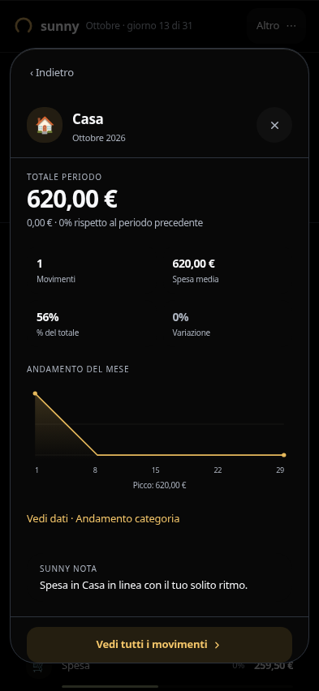
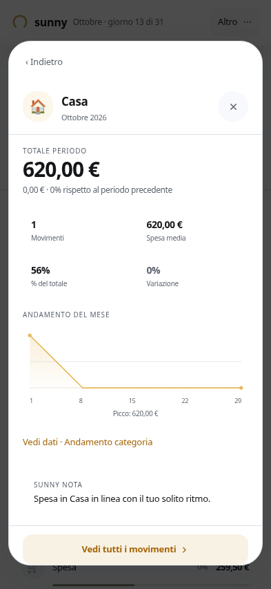

# Dialog UI3: bordo tagliato sotto la status bar

Segnalazione del 13 ottobre, dopo #146. Riprodotto nei dettagli categoria/conto: overlay da 852 px, padding superiore 59 px e inferiore 34 px, ma pannello alto fino a 828 px (viewport meno 24). Allineato in basso, il pannello iniziava a **−10 px**, tagliando gli angoli superiori e occupando la zona della status bar.

La superficie ora usa `max-height:100%` del contenuto dell'overlay, già ridotto dal padding effettivo. Nella stessa riproduzione occupa y=59…818, interamente nella zona utile. Una sola regola condivisa UI3; UI2, Wrapped, contenuti, navigazione e contratti di chiusura non modificati.

Verifica riproducibile: `SUNNY_BROWSER=/usr/bin/chromium node ui-preview/with-server.mjs liquid-safe-area.mjs`. Il test riproduce in Chromium il padding calcolato della safe area (non simula un dispositivo Safari reale), verifica entrambi i bordi e il ritorno senza elementi inert residui. Due temi × due configurazioni inset × categoria/conto: 8 casi. Prima fallisce sul bordo superiore; dopo passano tutti.

[Prima](evidence/safe-area/before.log) · [Dopo](evidence/safe-area/after.log)

Verifiche successive PASS: typecheck, build, suite dettagli nei due temi (categorie/conti/investimenti/impostazioni), dismiss di movimento/Piano nei due temi a 844 e 500 px, accessibilità (focus, contrasto campionato, reduced motion, footer ad altezza ridotta, testo 200%).
