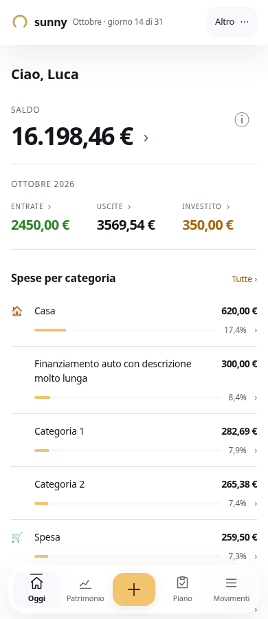
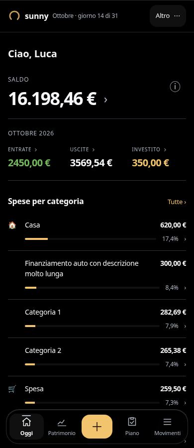
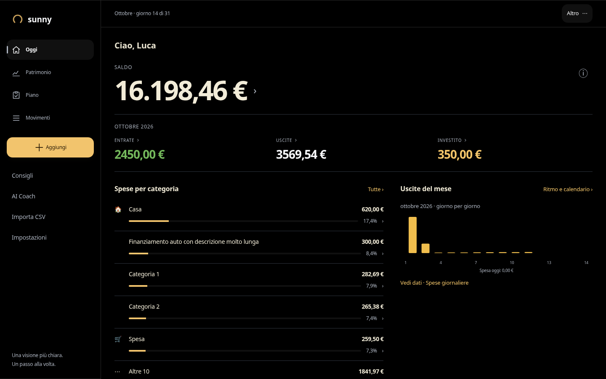
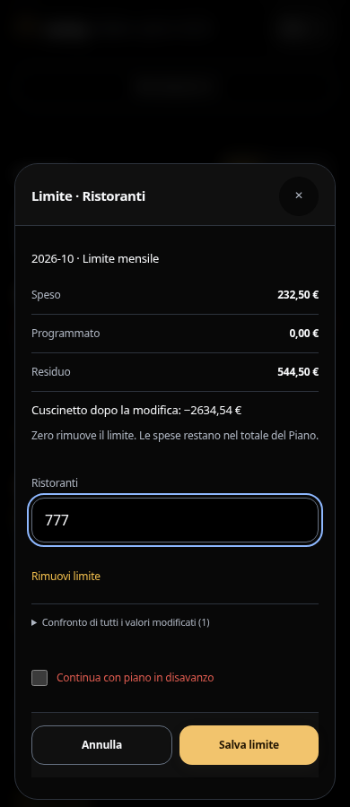

# Home più essenziale e budget per categoria — 14 ottobre 2026

Richiesta diretta di Luca, con conferma: mantenere il grande importo e chiamarlo **Saldo**. Branch `feat/ui3-minimal-home-category-budget`, basato su main `25ac19c` e sullo stesso commit della correzione safe-area #147 (`6ba6baa`, ancora aperta). Nessun merge/deploy in questa attività; rollout e permessi invariati.

## Home

- Saldo in evidenza; ⓘ apre un dettaglio con saldo, impegni, deposito e liquidità libera. Il perimetro e la differenza dal margine del Piano restano spiegati qui.
- Mese e tre valori leggibili: entrate, uscite, investito. Tolti “registrato”, la scorciatoia Impostazioni e gli ultimi movimenti.
- “Spese per categoria”: cinque categorie più Altre, importo e percentuale, barre con scala comune sul totale. Ogni categoria apre il proprio dettaglio nel mese corrente; Altre e Tutte aprono l'analisi completa. Stato vuoto esplicito.
- Andamento giornaliero secondario: colonne per quantità discrete, tap/tastiera per i movimenti del giorno. Desktop a due colonne, mobile in ordine saldo → mese → categorie → andamento.
- Rimossi i collegamenti duplicati a Patrimonio e Piano. Restano riepilogo, consigli e statistiche ulteriori espandibili, con riordino accessibile nel dettaglio.

## Piano

Ogni categoria ha “Imposta limite”/“Modifica limite”. L'editor dedicato contiene un solo importo, speso/programmato/residuo e impatto sul cuscinetto. “Imposta un limite” apre un selettore di categorie; anche nel wizard generale gli input delle spese si aprono una categoria alla volta. L'impostazione iniziale di entrate e obiettivi rimane disponibile.

Le modifiche dedicate usano una bozza separata per utente, mese e categoria. Aggiornano solo quel limite, preservando entrate, risparmio, investimenti, altri limiti e stato di revisione/conferma. Zero o “Rimuovi limite” rimuovono solo il limite scelto. L'editor non finge di aver verificato entrate/obiettivi quando il Piano è incompleto.

Restano conferma esplicita del disavanzo, conferma di scarto sovrapposta, salvataggio asincrono ed errori senza perdita di input. In caso di conflitto si ricarica il Piano aggiornato preservando il valore digitato per quella categoria; gli altri valori provengono dalla versione corrente. Il draft generale non viene cancellato né salvato implicitamente.

Review separata del sorgente: rilevato e risolto il caso categoria archiviata/eliminata con spese storiche ma senza limite. L'editor include sempre la categoria richiesta; test regressione fallito prima/passato dopo. Selettori e formule finanziarie, store transazionale, Wrapped e UI2 non modificati.

## Verifiche

- **839 test PASS, 5 skipped**, TZ UTC; typecheck e build PASS.
- Nuovo percorso browser: 6 combinazioni (chiaro/scuro × 390/834/1440) PASS. Saldo/dettagli, 5+Altre, navigazione da tastiera alla categoria, un solo input, scarto immobile/focus, salvataggio e riapertura, bozza generale conservata. Casi aggiuntivi errore/conflitto PASS; il risparmio cambiato sul server resta aggiornato dopo il salvataggio del limite.
- **36 aperture di rotte** interessate, senza overflow/errori JavaScript. Inventario: **591 dichiarazioni di controlli**, distinto dagli esiti runtime.
- Suite browser generale: 22/23 PASS nel giro completo; il test categoria cercava “Casa” sull'intera pagina e selezionava la nuova riga della home dietro l'editor. Reso il selettore specifico del dialog e rieseguito PASS. Le verifiche di focus restano invariate. Piano/accettazione/forecast, import, onboarding, bulk, errori, tastierino, scarto, accessibilità e navigazione PASS.
- Contesto dei periodi e priorità multiple PASS nei due temi. Verticale saldo → dettaglio → nuovo movimento → scarto → calendario → Impegni PASS in 6 combinazioni. Aggiornata la prova all'apertura di un nuovo movimento: la descrizione viene espansa prima dell'input, secondo il comportamento esistente.
- UI2: 12 aperture senza errori/overflow; a screenshot stabilizzati 10 immagini identiche e 2 con differenze minime di rasterizzazione (18/28 pixel di icone). Per Impostazioni ripetuto confronto contro main con animazioni disabilitate su entrambi i lati: identico.

- **32 casi stress a 320 px e testo 200% PASS**, con stati vuoti e importi/categorie estremi. [Esiti](evidence/minimal-home-budget/stress.json).
- **Wrapped: 24 immagini identiche SHA-256** alla baseline, incluse stories, riepilogo e obiettivo finale; verificati gesti/timer e pulizia del focus. [Confronto](evidence/minimal-home-budget/wrapped-comparison.json).

Le prove usano Chromium con fixture, senza scritture live. Non certificano Safari/iPhone fisico. Nessuna variazione alle impostazioni di rollout pubblico.

## Evidenze

[Esiti percorso dedicato](evidence/minimal-home-budget/results.json) · [Log](evidence/minimal-home-budget/home-budget.log) · [Rotte e controlli visibili](evidence/minimal-home-budget/routes.json) · [Inventario AST](evidence/minimal-home-budget/controls-source.json) · [Unit test](evidence/minimal-home-budget/unit-tests.log) · [Build](evidence/minimal-home-budget/build.log) · [Confronto UI2](evidence/minimal-home-budget/ui2-comparison.json).

| Home chiara | Home scura |
|---|---|
|  |  |

