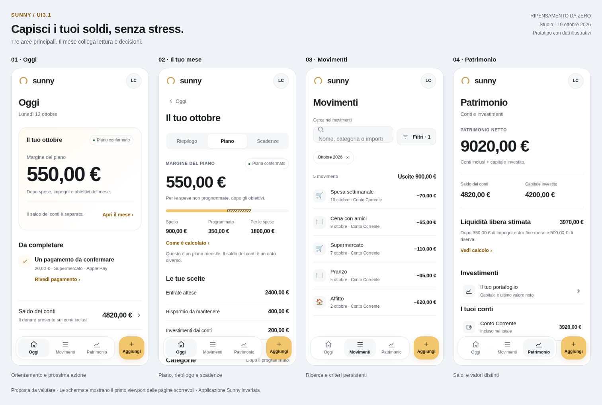

# Sunny UI3.1 — ripensata dalla sua filosofia

19 ottobre 2026 · **Nuova direzione**, successiva al primo studio incrementale. Proposta e prototipo di studio; nessuna modifica all’applicazione.

## La decisione

Sunny deve rendere comprensibili i soldi e lasciare all’utente il controllo delle scelte. La nuova esperienza parte da una visita breve: **capire il mese, completare ciò che serve, registrare o ritrovare un movimento**. Il dettaglio resta disponibile quando diventa utile.

Propongo tre destinazioni principali: **Oggi, Movimenti, Patrimonio**. Il mese diventa uno spazio completo collegato a Oggi, con Riepilogo, Piano e Scadenze. Aggiungi è un’azione separata dalle destinazioni, nel dock mobile e nella sidebar desktop. Il profilo raccoglie preferenze e gestione dei dati.

Questa scelta supera la precedente ipotesi di conservare quattro aree. È una raccomandazione da validare: chi usa spesso il Piano potrebbe preferire un accesso principale dedicato. Il test di reperibilità deve verificare questo costo prima dell’implementazione.

[Prototipo HTML navigabile](nuova-direzione/prototipo.html) · [Oggi desktop](nuova-direzione/desktop.png) · [Oggi scuro](nuova-direzione/oggi-scuro.png) · [Metodo e verifiche del prototipo](nuova-direzione/metodo.md).

## La filosofia, ricostruita dalle fonti

La promessa esplicita nell’onboarding è “Capisci i tuoi soldi, senza stress”. Login, obiettivi e specifica del Piano la traducono già in scelte concrete: nessun collegamento bancario richiesto, piano facoltativo, limiti per categoria facoltativi, obiettivi modificabili e nessuna AI necessaria per capire o modificare il piano.

Fonti: `WelcomeStep.tsx`, `GoalsStep.tsx`, `LoginScreen.tsx`, [specifica Piano](../2026-10-10-piano-redesign.md), `financialFlow.ts`. La seguente sintesi è un’interpretazione progettuale delle fonti, non un manifesto attribuito all’utente.

| Principio | Conseguenza nell’esperienza |
|---|---|
| Chiarezza prima della quantità | Una domanda dominante per vista; significato, periodo e provenienza dei numeri raggiungibili |
| Serenità senza nascondere i problemi | Avvisi pertinenti; niente voti di salute finanziaria, colpevolizzazione o congratulazioni automatiche |
| Autonomia | Piano e limiti sono scelte; nessun preset presentato come intenzione dell’utente |
| Poco lavoro quotidiano | Registrazione diretta, ricerca pronta, contesto conservato dopo i dettagli |
| Fiducia nei numeri | Registrato, programmato, pianificato e stimato distinguibili; assenza di dati diversa da zero |
| Profondità su richiesta | Analisi complete disponibili, AI facoltativa e contestuale |

La promessa d’uso proposta è: **aprire Sunny, capire che cosa sta succedendo e sapere qual è il prossimo passo utile**. La durata della visita non è un obiettivo di prodotto.

## Tre architetture considerate

| Architettura | Vantaggio | Limite |
|---|---|---|
| Quattro aree autonome, con Piano nella navigazione | Accesso diretto alle funzioni attuali | Controllo quotidiano e organizzazione del mese restano separati; una destinazione permane anche quando il piano non è usato |
| Tre aree, con il mese dentro Oggi | Collega osservazione e decisione; piano facoltativo; navigazione stabile senza investimenti | Il Piano richiede un passaggio in più da un’altra area |
| Assistente conversazionale come ingresso principale | Espressione libera dei bisogni | Minore prevedibilità; lettura e registrazione meno dirette; dipendenza dall’AI |

Scelta: **tre aree con percorsi espliciti**. Non è una prescrizione del database UI/UX Pro Max né una garanzia universale della migliore UX.

## La nuova mappa

| Destinazione | Compito | Contenuti |
|---|---|---|
| Oggi | Orientarsi e completare una cosa utile | Sintesi del mese, prima priorità, accesso al saldo, movimenti recenti |
| Il tuo mese, da Oggi | Capire e organizzare il mese scelto | Riepilogo delle spese; Piano; Scadenze effettive |
| Movimenti | Registrare, trovare, correggere | Ricerca, filtri combinabili, dettaglio, modifica, serie e selezione multipla |
| Patrimonio | Capire dove sono i soldi | Totale qualificato, conti, liquidità libera stimata, investimenti e storico |
| Profilo e impostazioni | Configurare e gestire i dati | Aspetto, funzioni attivate, conti/categorie, importazione, notifiche e account |

Oggi, Movimenti e Patrimonio sono destinazioni; Aggiungi apre un editor. Il dock mobile separa il gruppo di navigazione dal pulsante dorato, senza sovrapporre un pulsante flottante sopra i dati. Durante un editor il dock non compete con Salva.

Nel desktop la stessa gerarchia diventa sidebar. “Il tuo mese” è un collegamento secondario esplicito sotto Oggi. Le viste ampie usano due colonne; moduli e conferme mantengono una larghezza contenuta.

Le URL esistenti rimangono compatibili: `/budget` può presentare Il tuo mese con Piano selezionato; `/commitments` conserva l’accesso agli Impegni; analisi e deep link non spariscono. Non è richiesta una migrazione dei documenti finanziari.

## Oggi: una lettura breve

Ordine: titolo e data → **Il tuo mese** → **Da completare**, quando serve → saldo dei conti → ultimi tre movimenti. Categorie, calendario e serie storiche passano nel mese e nelle analisi. Non vengono eliminate.

| Stato | Sintesi | Qualificazione e azione |
|---|---|---|
| Piano confermato | Margine del piano | Mese e stato; dipendenza dagli incassi attesi quando presente; Apri il mese |
| Bozza | Margine della bozza, se calcolabile | Da confermare visibile; Rivedi e conferma |
| Piano assente/disattivato | Uscite registrate del mese | Nessuna disponibilità presunta; Esplora il mese; piano facoltativo |
| Piano incompleto | Dati registrati e completamento mirato | Nessun margine presunto; quale informazione manca |
| Entrate da incassare | Margine con avviso vicino al numero | Importo atteso e dipendenza visibili |
| Margine negativo | Importo negativo e conseguenza | Rivedi piano; nessun giudizio personale |
| Primo utilizzo senza conti | Primo passo, senza saldi presunti | Primo conto; importazione o esempio come alternative |
| Errore/dati non affidabili | Stato e recupero | Valore precedente qualificato se disponibile; niente zero sostitutivo |

Quando cambia la metrica, cambiano anche etichetta, spiegazione e contesto. Nessun numero è chiamato genericamente “disponibile” o “puoi spendere”. Chi non usa il Piano deve poter usare Sunny pienamente.

Una priorità mostra oggetto, motivo, eventuale data e azione. Un pagamento da confermare non scompare dietro un conteggio aggregato. Le altre priorità restano raggiungibili con quantità e natura; il ranking finanziario esistente rimane il riferimento. Una visita senza azioni richieste non genera una scheda riempitiva.

I consigli interpretativi entrano nella vista pertinente; l’elenco completo rimane raggiungibile dal mese e dalle analisi. Errori, ipotesi indispensabili e dati incompleti restano visibili.

## Il tuo mese: osservare e decidere insieme

Un mese selezionato, tre sezioni locali:

- **Riepilogo:** uscite registrate, entrate e flussi distinti, categorie, ritmo giornaliero, analisi e movimenti sottostanti.
- **Piano:** margine, stato, entrate attese, risparmio da mantenere, investimenti dai conti, limiti facoltativi e decisioni pertinenti. Riutilizza il Piano corretto.
- **Scadenze:** occorrenze effettive del mese, importi e serie. Impegni rimane il percorso per gestire le serie e leggerne il costo equivalente.

La home apre la sezione coerente con il dato toccato: margine → Piano, uscite → Riepilogo. Il periodo è locale e non cambia implicitamente altri tab. Le scadenze sono raggiungibili senza dipendere da un consiglio occasionale.

Nessun limite obbligatorio per ogni categoria o allocazione obbligatoria di ogni euro. Risparmio pianificato diverso da denaro accantonato. Forecast etichettato come stima del totale finale, non come importo da aggiungere.

Una categoria apre prima il dettaglio: speso, programmato, limite, residuo, eventuale previsione qualificata e movimenti. Da lì si modifica il limite o si sposta budget con anteprima prima/dopo. Modificare un limite non conferma un piano incompleto e non trasferisce denaro tra conti.

## Movimenti: il registro su cui fare affidamento

Titolo stabile, ricerca disponibile e **Filtri sempre visibile fuori dallo scroller dei tipi**. I criteri attivi vanno a capo. Il periodo rimane leggibile.

Rimuovere categoria conserva ricerca, conto, periodo e ordinamento. Azzera filtri conserva la ricerca; Cancella ricerca agisce solo sul testo. I risultati vuoti mantengono i criteri e offrono correzioni mirate.

Descrizione, data, conto e importo permettono di riconoscere una registrazione. Registrato e programmato sono gruppi distinguibili. Trasferimenti, storni, investimenti e quote personali conservano significato; i tipi misti non diventano genericamente “spese”.

Dettaglio → modifica → ritorno conserva filtri, ricerca e scroll. Se la modifica fa uscire il movimento dalla selezione, comunicarlo senza cambiare i criteri. Selezione multipla come modalità esplicita, con quantità, ambito, restrizioni ed effetti visibili.

## Registrare e correggere

Aggiungi apre direttamente il tipo predefinito attuale; cambio tipo visibile, senza un passaggio obbligatorio nuovo prima dell’importo. Ordine: importo, descrizione facoltativa subito sotto, categoria con emoji personale, conto/data, dettagli del tipo.

Ricorrenza, rate, condivisione, TFR, commissioni, distribuzione statistica e storni restano disponibili in gruppi nominati. Una modifica di serie dichiara quali occorrenze coinvolge.

Salva raggiungibile con tastiera aperta; tastierino alternativo secondo contratto attuale. Una sola scrittura per invio. Conferma breve e accesso al movimento scritto, senza rubare focus. Il feedback non scade durante l’interazione. Nessun finto Annulla dopo una scrittura senza undo reale.

In errore: valori conservati e recupero. Bozza locale diversa da sincronizzazione riuscita. Chiusura immediata senza modifiche; con modifiche, conferma sopra il form montato. Continua conserva valori, focus e scroll; Escape/backdrop non scartano implicitamente. Durante il salvataggio lo stato è esplicito.

## Patrimonio: quantità con un nome preciso

Totale qualificato secondo la definizione esistente: conti inclusi, capitale investito e controvalore non sono intercambiabili. Nessuna sostituzione silenziosa del capitale con l’ultimo valore di mercato.

Conti → dettaglio → movimenti coerenti, includendo i lati dei trasferimenti. Investimenti → posizione → ultimo controvalore noto e aggiornamento → operazione o approfondimento. Versato, rendimento e controvalore non condividono un’etichetta generica.

La liquidità libera stimata ha qui un posto stabile: saldo incluso meno impegni nell’orizzonte dichiarato e riserva. Rimane distinta dal margine del Piano. Funzioni e orizzonti rispettano i gate: la nuova disposizione non abilita `available_cash` o altri esperimenti.

Storico con periodo, legenda, scala, tabella e metodo. Nessun andamento di mercato inventato dai versamenti, nessun rendimento dedotto da differenze improprie.

## Entrare senza un questionario

Proposta in tre momenti, preservando Google Auth e contratti dati:

1. **Scegli da dove partire:** manuale, CSV, esempio, con conseguenze chiare e demo riconoscibile.
2. **Rendi comprensibili i dati:** primo conto e saldo dichiarato, oppure mapping/controllo dell’importazione. “Non lo so” non diventa zero; si può rimandare.
3. **Ottieni la prima lettura:** riepilogo effettivo e passo pertinente. Piano, limiti e obiettivi possono essere proposti nel contesto dopo il primo risultato utile.

Importazione con anteprima, mapping, errori e conferma prima delle scritture. Il passaggio dall’esempio ai dati reali dichiara gli effetti, senza mescolanza silenziosa. Non promettere collegamenti bancari, cifratura o automazioni inesistenti.

## Tutte le funzioni restano raggiungibili

| Funzione | Nuova collocazione | Invariante |
|---|---|---|
| Entrate, categorie, ritmo | Riepilogo del mese e analisi | Periodi, quote, storni e movimenti coerenti |
| Piano e archivio | Piano del mese | Formule, bozza/conferma, indipendenza da UI3 e limiti facoltativi |
| Impegni e ricorrenze | Scadenze → Impegni | Occorrenze diverse dal costo mensile equivalente |
| Consigli | Mese e dettagli pertinenti, elenco completo raggiungibile | Ranking, calcoli e disponibilità |
| AI Coach e scenari | Azioni contestuali e accesso completo quando abilitato | AI facoltativa; calcoli deterministici; applicazione esplicita |
| Investimenti e storico | Patrimonio | Capitale, controvalore, dati mancanti e aggiornamento |
| Forecast avanzati, Patrimonio V2, Piano mensile sperimentale, Metriche | Analisi avanzate per utenti già autorizzati | Nessuna fusione dei modelli o modifica di permessi/rollout |
| Riepilogo mensile | Archivio del mese | Retrospettiva distinta dalla previsione |
| Wrapped | Ingresso stagionale in Oggi e percorso attuale | Temi, storie, calcoli, timer, gesti, riepilogo e obiettivo |
| Impostazioni e gestione dati | Profilo, con scorciatoie pertinenti | Preferenze, errori visibili, azioni distruttive separate |

I punti di accesso a Consigli, AI e analisi avanzate sono requisiti del progetto completo; non tutte queste interazioni sono dimostrate dal prototipo ridotto.

## Linguaggio visivo e verbale

Bianco luminoso, nero profondo e oro Sunny. La famiglia tipografica già adottata, gerarchia chiara e cifre tabulari. Personalità da arco, luce, proporzioni e ritmo, senza attribuire uno stato finanziario al colore decorativo.

Profondità su navigazione e finestre, superfici stabili per dati e liste. Un contenitore per un compito, righe per elementi dello stesso gruppo. Testo di lettura 16 px, secondario 14, metadati 12–13; importi adattivi; spazi 4/8/12/16/24/32. Principali controlli touch da 44 CSS px come obiettivo ergonomico, distinto dal criterio web AA di 24 px con eccezioni.

Icone strutturali vettoriali, emoji personali conservate. Grafici con focus/tocco, dati leggibili e testo oltre al colore. Movimento breve per esito e continuità, interrompibile e riducibile; niente attesa per leggere i numeri.

Tono: “Il pagamento non è ancora registrato”; “Il margine dipende dall’arrivo di queste entrate”; “Questa categoria supera il limite di X”. Nessun giudizio morale o diagnosi emotiva. Non dire “tutto sotto controllo” se mancano dati.

## Prototipo e dati illustrativi

Il prototipo è autonomo, senza dipendenze esterne o persistenza, escluso dalla build Sunny. Dimostra navigazione, mese, ricerca/categoria, aggiunta/modifica di un’uscita, conferma Apple Pay, errore/scarto e stati alternativi. I controlli di revisione esterni permettono di scegliere tema e scenario.

Scenario comune: entrate attese 2400 €, risparmio 400 €, investimenti dai conti 200 €, speso 900 €, programmato 350 € → **margine 550 €**. Saldo 4820 €, riserva 500 € → **liquidità libera stimata 3970 €**. Capitale investito 4200 € → totale secondo base capitale **9020 €**. Sono esempi distinti dalla fixture dell’audit precedente.

Un’uscita aggiorna coerentemente questi valori nella simulazione. Il prototipo non sostituisce i motori reali né implementa tutti i tipi di movimento, importazione, serie, AI, forecast, permessi o offline. In produzione si riusano selettori e contratti Sunny.

Le 60 viste e 16 sonde del primo audit restano evidenza dell’app attuale; non sono test della nuova esperienza. Le verifiche del prototipo sono registrate separatamente in [verifica-prototipo.json](nuova-direzione/verifica-prototipo.json).

## Come scegliere con evidenza

Confrontare tre e quattro aree sugli stessi compiti: trovare il margine, capire gli incassi futuri, modificare un limite, trovare/correggere un movimento, distinguere saldo e controvalore. Includere chi pianifica spesso e chi non usa il Piano.

Misurare primo clic corretto, interpretazioni errate, completamento, azioni e ritorni involontari. Mantenere tre aree se il mese si trova senza tentativi e il costo aggiuntivo è accettabile; altrimenti promuovere Il tuo mese tra le destinazioni. Il numero di tab non è un principio ideologico.

Futura verticale: Oggi → mese → categoria → movimento → modifica → ritorno; poi Patrimonio, onboarding e aree avanzate. Verificare entrambi i temi, 320/390/834/1440 px, testo 200%, tastiera, reduced motion, safe area, errori e dispositivi reali. Nessuna percentuale di miglioramento dell’usabilità è stata inventata.

## Provenienza

Applicate brainstorming e [UI/UX Pro Max](https://github.com/nextlevelbuilder/ui-ux-pro-max-skill), revisione `56ea9cf174ed86786187daa9de0e6247cb0747e4`. Le ricerche sui sistemi visivi hanno restituito anche strutture promozionali non pertinenti, scartate. Si applica la guida verificata su feedback/tastiera e la checklist generale su gerarchia, stati e navigazione. Le tre destinazioni e il ruolo della home sono decisioni motivate da Sunny, non output attribuiti al database.

La prima ipotesi è conservata come [studio incrementale](studio-incrementale.md), con [metodo ed evidenze](metodo-e-verifiche.md). Questa direzione ne sostituisce le raccomandazioni di struttura e gerarchia, mantenendo validi i problemi riprodotti e i contratti finanziari.

Consegna di studio: documenti, prototipo e immagini. Nessuna modifica al prodotto, merge, deploy o rollout. UI3.1 è un nome di progetto; il resolver continua a gestire UI2/UI3.
