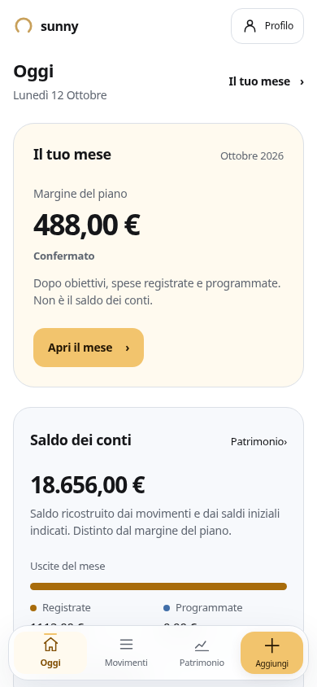
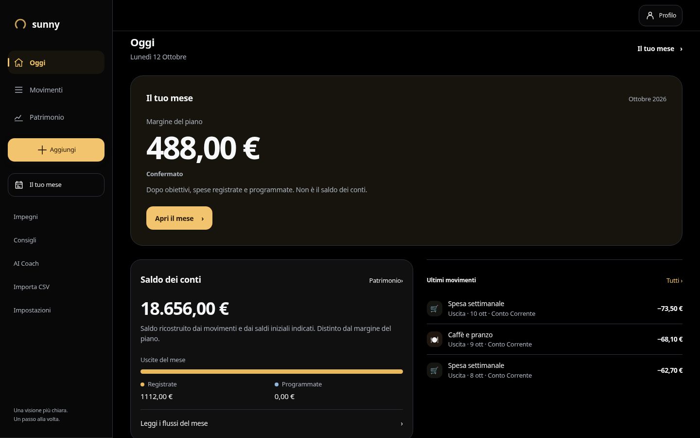
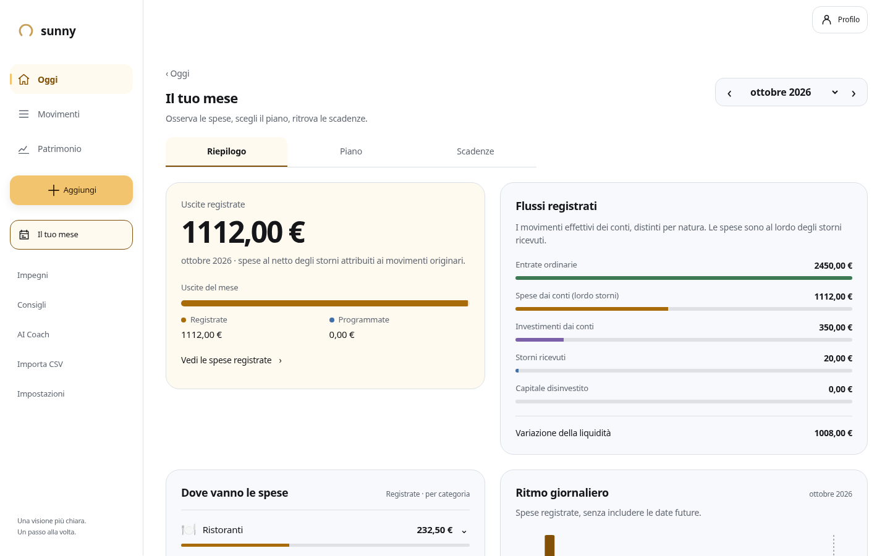

# Sunny UI3.1 — implementazione

La [direzione approvata](../README.md) è implementata nel branch `feat/sunny-ui31-experience`, sulla base `7f18647`. Le schermate qui sotto usano dati illustrativi.

## Esperienza

- **Oggi:** data, sintesi mensile qualificata, prima priorità visibile, saldo dei conti e tre movimenti registrati. Un saldo iniziale rimandato e senza movimenti resta distinto da uno zero dichiarato. Piano incompleto, assente o disattivato non produce una disponibilità presunta. Errori e caricamenti sospendono i dati dipendenti.
- **Il tuo mese:** riepilogo, piano facoltativo e scadenze condividono un solo periodo. Composizione delle spese, flussi per natura, categorie espandibili e ritmo giornaliero si basano sui selettori esistenti. I collegamenti alle analisi conservano il mese; quelli di Oggi aprono il mese corrente.
- **Movimenti:** ricerca visibile, Filtri raggiungibile anche dopo lo scorrimento dei tipi, criteri rimovibili senza perdere la selezione restante. Modifica, storni, serie e azioni multiple conservano i contratti finanziari. L’editor torna al movimento di origine; Apple Pay mantiene il tipo uscita.
- **Patrimonio e analisi:** capitale, saldo e ultimo valore di mercato hanno nomi e basi distinti. Storico, composizione, dati testuali e serie distinguibili anche tramite tratteggio. La liquidità libera stimata ha il suo spazio, con riserva, uscite e orizzonte espliciti, secondo il gate `available_cash` esistente.
- **Ingresso e impostazioni:** origine dei dati → conto/validazione → prima lettura reale. Preferenze e obiettivi sono facoltativi; nessun importo di risparmio viene preimpostato. Gli identificativi persistiti dei passi restano compatibili. Le impostazioni hanno gruppi, ricerca e feedback sul risultato.

La navigazione usa dock sotto 768 px, rail da 768 a 1099 px e sidebar da 1100 px. I layout, i controlli touch e gli spazi dipendono dalle dimensioni disponibili. Oro Sunny, blu, verde e malva distinguono le informazioni; login e impostazioni non ricevono grafici decorativi.

Consigli, AI Coach, riepiloghi e viste avanzate usano le basi condivise e mantengono i propri accessi e modelli. UI3.1 aggiorna il pilota UI3; il resolver delle versioni, la UI2 pubblica e Wrapped conservano il comportamento esistente.

## Schermate

| Telefono | Desktop |
|---|---|
|  |  |



[Patrimonio su telefono](schermate/patrimonio-mobile-scuro.png) · [Prima lettura su tablet](schermate/prima-lettura-tablet.png)

## Verifiche

Esiti e copertura sono registrati in [verifiche.json](verifiche.json).

- `npm test`: **930 passati, 5 esclusi**, nessun fallimento; baseline 852 passati e 5 esclusi.
- `npm run build`: riuscita con TypeScript e Vite.
- **19 rotte × 4 larghezze × 2 temi = 152 viste**, senza errori JavaScript o overflow orizzontale.
- **25 scenari/script browser esistenti**, con aspettative aggiornate dove la UI3.1 sposta o espone un controllo. Tre esecuzioni iniziali non riuscite sono state corrette e rieseguite individualmente, preservando le asserzioni sui dati e sul comportamento.
- Nuovo `ui31-acceptance.mjs`: otto combinazioni di larghezza/tema, navigazione, periodo storico e ritorno, filtri e ricerca, focus dopo modifica, Piano disattivato e blocco del tipo Apple Pay.
- Primo accesso: saldo assente e zero dichiarato in 16 casi sulle otto combinazioni; patrimonio e stima della liquidità rispettano la disponibilità dei dati.
- Tastiera: quattro casi, viewport visivo ridotto, bozza conservata, titolo unico e Salva sopra la tastiera. Touch tablet, testo al 200%, reduced motion, focus nei dialoghi e ripristino del focus verificati.
- Formule del Piano, spostamento dei limiti, mesi futuri/storici, cambio utente, errori di scrittura, importazione, investimenti e Wrapped verificati dagli script pertinenti. Wrapped conserva palette e durata sia in UI2 sia in UI3.1, in entrambi i temi.

La revisione indipendente è conclusa senza rilievi P1/P2 aperti. Ha verificato e fatto correggere il periodo dei collegamenti, il vincolo del tipo Apple Pay e lo spostamento della liquidità libera.

Le prove usano Chromium, viewport e touch simulati, fixture locali e scritture simulate. L’uso su hardware fisico e rete mobile reale resta da misurare. Il chunk applicativo iniziale è 157,23 kB gzip, contro 150,14 kB della baseline; Vite segnala la dimensione non compressa oltre 500 kB.

## Riproduzione

Da `sunny/`, con dipendenze installate:

```bash
npm test
npm run build
SUNNY_PREVIEW_STATIC=1 node node_modules/vite/bin/vite.js --config ui-preview/vite.config.mjs
```

In un secondo terminale, indicando il Chromium e il pacchetto Playwright disponibili nell’ambiente:

```bash
SUNNY_BROWSER=/usr/bin/chromium node ui-preview/ui31-acceptance.mjs
SUNNY_BROWSER=/usr/bin/chromium node ui-preview/ui31-first-use.mjs
SUNNY_BROWSER=/usr/bin/chromium node ui-preview/liquid-suites.mjs
SUNNY_BROWSER=/usr/bin/chromium node ui-preview/liquid-keyboard.mjs
SUNNY_WIDTHS=320,390,834,1440 SUNNY_STABLE=1 node ui-preview/liquid-baseline.mjs
```

L’anteprima è `/ui-preview/index.html?ui=3&theme=light` sulla porta 4177. Il percorso è locale e separato dall’entry di produzione. Le scritture ordinarie mantengono il comportamento offline esistente; i flussi con salvataggio atteso conservano il form e consentono di riprovare su errore.
