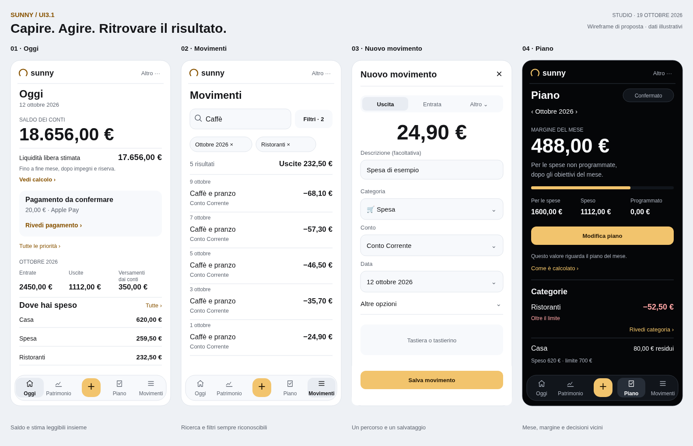

# Prima ipotesi UI3.1 — studio incrementale archiviato

Questa ipotesi precede la richiesta di ripensare Sunny da zero. Per la direzione attuale leggere [il nuovo studio](README.md). Le evidenze restano valide per la baseline esaminata.

19 ottobre 2026 · base `7f1864731eb8c4b642261aed125d1002c743ef8f`.
Stato: **proposta da valutare**, con audit della UI esistente e wireframe di progetto. Non è una versione implementata.

## Direzione raccomandata

UI3.1 deve aiutare a **capire la situazione, intervenire e ritrovare il risultato**. L’identità di Sunny è già definita: bianco/nero, oro, numeri evidenti, liste con divisori, vetro selettivo. Il prossimo salto riguarda soprattutto la gerarchia delle informazioni e la continuità dei percorsi.

Raccomando di conservare Oggi, Patrimonio, Piano e Movimenti, con Aggiungi al centro, e riprogettare il passaggio tra queste aree. Le prime correzioni riguardano i filtri fuori vista, le ricerche cancellate incidentalmente e le priorità nascoste. Poi rendere visibile la distinzione fra saldo, liquidità libera e margine; infine consolidare presentazione e componenti.

[SVG modificabile](proposta-wireframe.svg). I wireframe mostrano gerarchia e contenuti proposti, con dati illustrativi. Non sono screenshot di un prodotto già modificato né un prototipo interattivo. Il pannello Piano mostra un estratto della pagina, non tutte le sezioni.

## Obiettivo e vincoli

La richiesta comprende tutti e tre gli obiettivi: revisione complessiva, registrazione/gestione più rapida dei movimenti, comprensione immediata della situazione e delle prossime azioni.

Assunzione di progetto: uso personale frequente su telefono, con lettura più ampia su desktop. Non sono state condotte interviste: frequenza d’uso, bisogni e comprensione vanno validati con persone, non dedotti dai soli screenshot.

UI3.1 indica qui la prossima revisione di prodotto. Il codice supporta ancora `2.0 | 3.0`: UI3 è riservata al pilot admin, gli altri utenti ricevono UI2. I riferimenti storici a `Sunny-Design-Study-v3.1` nei piani del 2 ottobre rimandano a un pacchetto esterno Windows, assente da questo checkout; non costituiscono una specifica UI3.1 recuperata.

Restano contratti di riferimento:

- significato e formule di saldo, patrimonio, investimenti, storni, quote, Piano e previsioni;
- ordine del movimento: importo, descrizione subito sotto, categoria con emoji, campi successivi e opzioni avanzate;
- nuovo Piano disponibile anche in UI2; nessuna fusione con il Piano mensile sperimentale;
- permessi, feature gate, autenticazione, integrazione Apple Pay e rollout;
- Wrapped chiaro/scuro già integrato il 19 ottobre: mantenere entrambe le versioni e il comportamento attuale;
- niente nuovi dati finanziari simulati nel prodotto, né storici di mercato ricostruiti da versamenti.

## Metodo e baseline

Applicata la skill ufficiale **[UI/UX Pro Max](https://github.com/nextlevelbuilder/ui-ux-pro-max-skill)**, revisione `56ea9cf174ed86786187daa9de0e6247cb0747e4`: lette la skill e le checklist di accessibilità, interazione, moduli, navigazione, responsive e grafici. Stack rilevato: React 18, TypeScript, Vite e Tailwind. [Ricerche, selezione dei risultati e riproduzione](metodo-e-verifiche.md).

Lo studio del 18 ottobre e i suoi risultati restano evidenza storica. Questa analisi parte dalla versione successiva alle correzioni UI/UX e all’aggiunta di Wrapped chiaro. Non ripropone come mancanti le correzioni già integrate su contrasto dei selettori, importo Versa, focus dei filtri e interazione dei grafici.

La nuova baseline comprende dieci rotte nei due temi a 320, 390 e 1440 px: Oggi, Patrimonio, Piano, Movimenti, Investimenti, Saldo per conto, Spese per categoria, Consigli, Impostazioni e Impegni. Le sonde aggiuntive esaminano saldo, priorità multiple, ricerca con filtri, editor, funzionalità disattivate, utente normale, errore del Piano e ingresso onboarding.

Tutte le acquisizioni usano la preview separata con dati illustrativi e data fissa **12 ottobre 2026**. Non accedono a Firebase. Il saldo positivo nello scenario senza movimenti deriva dai saldi iniziali della fixture: “nessun movimento” non significa “nessun denaro”.

## Problemi ancora presenti

| Priorità | Evidenza attuale | Conseguenza per l’utente | Decisione UI3.1 |
|---|---|---|---|
| P1 | A 390 px Filtri inizia a x≈414, fuori dal viewport, dentro la riga orizzontale dei tipi | Un comando fondamentale richiede di scoprire uno scorrimento senza indicazione visibile | Filtri sempre visibile accanto alla ricerca; solo i tipi possono scorrere |
| P1 | Cercare “Caffè” con categoria e periodo, poi rimuovere la categoria, chiude la ricerca e cancella il testo | Cambiare un criterio cambia anche criteri indipendenti, ampliando i risultati in modo inatteso | Rimuovere una chip modifica soltanto quel criterio; ricerca, periodo e ordinamento restano |
| P1 | Con un pagamento Apple Pay e due scadenze, la home mostra solo “3 elementi da rivedere” finché non si espande il gruppo | La natura dell’azione richiesta e il pagamento non registrato scompaiono dalla lettura iniziale | Primo elemento operativo sempre visibile; resto del gruppo espandibile con numero e natura degli elementi |
| P2 | Saldo 18.656 € in home; liquidità libera stimata 17.656 € soltanto nella finestra informativa | Occorre aprire una spiegazione per capire l’effetto di impegni e riserva | Saldo dei conti dominante; liquidità libera stimata come riga secondaria visibile, con orizzonte e accesso al calcolo |
| P2 | “Investito” in home indica il flusso del mese; la stessa parola nella composizione patrimoniale indica uno stock | Il medesimo termine può far confrontare grandezze differenti | “Versamenti dai conti” nel periodo del mese per il flusso, escludendo TFR e apporti esterni come oggi; per gli stock usare l’etichetta esatta della metrica esistente, distinguendo capitale e controvalore |
| P2 | Aprire Cerca sostituisce il titolo e lascia la pagina senza `h1` | L’identità della pagina sparisce durante il compito | Titolo Movimenti stabile; campo di ricerca autonomo con etichetta accessibile |
| P2 | La testata globale mostra il giorno corrente anche nelle pagine con un periodo proprio | Il contesto temporale può risultare concorrente | Data di oggi nella home; periodo vicino ai dati nelle analisi e nel Piano, senza selettore globale ambiguo |

Le prime tre osservazioni sono riprodotte nei due temi. La perdita del titolo e dei criteri ha riscontro sia nelle sonde sia nel sorgente. La confusione tra metriche è un rischio di comprensione da validare con utenti; non è una prova di formule errate. Nessun P0 identificato in questo studio.

Cause nel codice da considerare nella futura implementazione:

- `TransactionList.tsx`: Filtri condivide lo scroller dei tipi; lo stato della ricerca usa l’intera query come chiave; Cercare sostituisce l’`h1`.
- `DashboardV2.tsx`: più priorità vengono interamente racchiuse in un `details` inizialmente chiuso.
- `FreeCashHero.tsx`: UI3 espone il saldo, con la liquidità libera nel dialog informativo.
- `AppHeader.tsx`: la riga del giorno è comune a tutte le rotte.

## Tre approcci confrontati

| Approccio | Vantaggio | Costo o limite | Valutazione |
|---|---|---|---|
| Rifinitura visiva della UI3 | Bassa discontinuità; interventi piccoli | Non risolve i cambi di contesto e le azioni nascoste | Utile come ultima fase |
| Revisione dei percorsi, mantenendo le quattro aree | Migliora i compiti frequenti e preserva orientamento e deep link | Richiede contratti espliciti di stato, ritorno e informazione | **Raccomandato** |
| Nuova architettura con home operativa e nuova navigazione | Libertà di ricomporre tutte le funzioni | Ri-apprendimento, migrazione dei collegamenti e validazione più ampia | Da rivalutare solo con evidenza d’uso |

## Architettura dell’esperienza

| Area | Domanda principale | Contenuto iniziale | Azione contestuale |
|---|---|---|---|
| Oggi | Qual è la situazione e cosa richiede attenzione? | Saldo dei conti, liquidità libera stimata, prima priorità, flussi del mese | Gestire la priorità; Aggiungi resta accessibile |
| Patrimonio | Dove sono i miei soldi e come cambiano? | Patrimonio netto, composizione, conti e investimenti | Aprire conto o posizione |
| Piano | Come sta andando il mese rispetto a ciò che ho deciso? | Margine, stato del piano, avvisi indispensabili, categorie da rivedere | Completare/rivedere il piano oppure intervenire sulla categoria |
| Movimenti | Quale registrazione cerco o devo correggere? | Ricerca, Filtri visibile, criteri attivi e lista | Aprire/modificare il movimento |

Mobile conserva quattro destinazioni e il comando centrale Aggiungi. Le etichette restano visibili; Aggiungi è un’azione, non una quinta pagina. Tablet e desktop adattano la navigazione alle dimensioni, senza cambiare la gerarchia. Il desktop usa liste e grafici più larghi, con moduli contenuti.

Altro mantiene una posizione stabile e contiene Impegni, Consigli, AI Coach se abilitato, Importa e Impostazioni. I collegamenti contestuali restano scorciatoie aggiuntive. Non aggiungere una nuova area “Analisi” che duplichi le destinazioni esistenti. Le funzioni sperimentali continuano a rispettare i rispettivi gate.

Titolo di pagina stabile. Il saluto può essere secondario in Oggi; nelle altre schermate prevale il compito. Il cambio di periodo appartiene alla singola vista, senza alterare implicitamente il Piano o altri tab.

## Percorsi da riprogettare

### 1. Capire la situazione e agire

Oggi → saldo dei conti → dettaglio dei conti → movimenti del conto → movimento.

Accanto al saldo, una riga rende leggibile la liquidità libera stimata **dopo impegni entro fine mese e riserva**. Il calcolo resta quello esistente; se i dati non permettono una stima attendibile, indicare indisponibilità o qualificazione invece di mostrare uno zero rassicurante. Il margine del Piano resta distinto, raggiungibile dal tab Piano. Non chiamare nessuno dei due valori “puoi spendere” come garanzia.

La priorità aperta mostra oggetto, motivo, eventuale data e azione: per esempio “Pagamento da confermare · 20 € · Rivedi”. Altre priorità restano espandibili. Non usare un numero aggregato come unico segnale; non cambiare il ranking finanziario in questo intervento. Per l’Apple Pay multiplo usare la selezione già prevista dal prodotto, senza forzare un’attribuzione automatica.

Categorie e grafico giornaliero rispondono a due domande diverse: dove e quando ho speso. Il tocco apre un dettaglio con periodo esplicito; da lì i movimenti riconciliano il totale. Il ritorno conserva origine, periodo, filtri e posizione.

La riga dei flussi del mese conserva `ordinaryIncome`, `expenses` e `investedFromAccounts`: l’ultima voce riguarda i depositi finanziati dai conti, senza TFR e apporti esterni. I disinvestimenti rimangono capitale rientrato, non versamenti negativi. Eventuali componenti aggiuntivi restano nel dettaglio del flusso.

### 2. Registrare un movimento

Aggiungi → editor → Salva → esito con accesso al movimento appena registrato.

Conservare l’accesso diretto al tipo predefinito già usato da Sunny e il cambio di tipo visibile. Non introdurre una nuova scelta obbligatoria prima dell’importo. L’importo resta dominante; la descrizione facoltativa resta subito sotto, anche nella sua forma compatta apribile. Categoria, conto e data hanno valori chiaramente visibili; niente associazioni nuove silenziose.

Opzioni meno frequenti in gruppi nominati: condivisione, ricorrenza/rate e dettagli specifici del tipo. Storni, trasferimenti, TFR, commissioni e distribuzione statistica conservano i contratti esistenti. “Modifica solo questo” e “Modifica la serie” devono dire quale oggetto verrà scritto.

Una sola zona primaria di salvataggio, raggiungibile con tastiera aperta; la combinazione tastierino/tastiera segue l’implementazione esistente e va provata su dispositivo. Non aggiungere un’altra CTA concorrente nel dock dietro l’editor.

Esito: conferma breve, contestuale e annunciata, con “Vedi movimento” quando l’operazione restituisce un’identità valida. Non introdurre un finto Annulla dopo scritture irreversibili. In errore: valori conservati, causa comprensibile e Riprova. Distinguere bozza locale, scrittura pendente e sincronizzazione completata solo quando il servizio distingue realmente questi stati.

### 3. Trovare e correggere una registrazione

Movimenti → ricerca/filtri → dettaglio → modifica → ritorno allo stesso risultato.

Campo di ricerca disponibile senza far sparire il titolo. Filtri ancorato fuori dallo scroller dei tipi, con conteggio dei criteri aggiuntivi attivi. Criteri rimovibili individualmente; “Azzera filtri” ha un ambito esplicito e non cancella il testo di ricerca. La ricerca ha il proprio comando Cancella.

Periodo, categoria, conto, serie, tipo e ricerca possono intersecare i risultati: il riepilogo deve descrivere la selezione corrente. Nei gruppi distinguere flusso netto, uscite e trasferimenti: non sommare tipi diversi sotto un totale generico di “spese”. Conservare i filtri URL già supportati e la selezione in sessione; definire un solo stato coerente per ciascun criterio.

Nessun risultato mostra ricerca e criteri ancora attivi, con modifica o rimozione mirata. La selezione multipla è una modalità esplicita con quantità selezionata, azioni applicabili e conseguenza dell’eliminazione. Conservare il blocco delle azioni durante la scrittura e le restrizioni sulle categorie di tipi misti.

### 4. Rivedere il mese

Piano → decisione/categoria → modifica mirata → ricalcolo → conferma.

Mantenere il margine come numero dominante, con mese e stato vicini. Entrate attese non incassate, margine negativo e bozza non confermata restano visibili. “Non è il saldo di oggi” può diventare una spiegazione più diretta: “Questo valore riguarda il piano del mese”, con collegamento a come è calcolato; la distinzione rimane presente.

Portare le decisioni che richiedono intervento vicino al margine. Dati di supporto e metodo restano progressivi; non spostare in disclosure le ipotesi necessarie a interpretare il risultato. Categorie: residuo, speso/programmato e stato; il forecast resta una stima del totale finale, non un importo da sommare.

L’editor aperto da una categoria mantiene la sezione e il mese richiesti. Salvataggio e conferma del piano restano semanticamente distinti; una bozza non diventa confermata perché si è chiusa una finestra. Nessuna nuova formula o piano parallelo.

## Copertura delle altre schermate

| Schermata | Indicazione UI3.1 | Contratto da conservare |
|---|---|---|
| Patrimonio | Totale dominante, composizione e accesso ai conti; qualificazione visibile del valore | Distinzione tra inclusione degli investimenti nel totale e abilitazione della relativa sezione |
| Investimenti / fondo | Ultimo controvalore noto e aggiornamento vicini al totale; operazioni prima delle statistiche estese | Versato ≠ controvalore ≠ rendimento; non creare storico mancante |
| Saldo per conto | Saldo e periodo espliciti; conto → movimenti coerenti | Trasferimenti sui due lati, conti inclusi/esclusi, saldi iniziali |
| Entrate / spese per categoria | Barre ordinate, importi diretti e passaggio alla lista filtrata | Quote proprie, storni e intervallo usato nel totale |
| Storico patrimonio | Legenda leggibile, periodo e tabella; stato di ricostruzione vicino al dato | Serie e metodo attuali, senza inventare valori di mercato |
| Impegni | Prossima scadenza e serie; separare evento e costo mensile equivalente | Proiezione ≠ movimento già registrato; gate invariati |
| Consigli | Primo consiglio e azione; motivazione e altre analisi progressive | Ranking, confidenza e significato dei numeri |
| AI Coach | Domanda, contesto usato, esito e azione confermabile | L’AI spiega i risultati; non sostituisce il motore dei calcoli |
| Forecast / Patrimonio V2 / Piano mensile / Metriche | Collocazione avanzata e intestazioni coerenti; chiarire finalità sperimentale dove già prevista | Nessuna promozione automatica, fusione di modelli o modifica dei permessi |
| Riepilogo mensile | Lettura retrospettiva con periodo; collegamenti ai dettagli | Distinzione rispetto a proiezioni e Wrapped |
| Impostazioni | Ricerca e gruppi chiari: aspetto, dati, funzioni, account | Azioni distruttive separate; stato e fallimento dei salvataggi visibili |
| Login / onboarding / importazione | Obiettivo chiaro, avanzamento e percorso di recupero; esempio dichiarato come esempio | Google Auth e dati reali; controllo/validazione prima delle scritture importate |
| Wrapped | Preservare temi attuali e accesso esistente | Storie, ordine, timer, gesti, calcoli, riepilogo, obiettivo e condivisione |

Questa tabella comprende anche aree esaminate solo nel sorgente e nella documentazione: non estende la matrice browser oltre le dieci rotte dichiarate.

## Grammatica visiva UI3.1

Mantenere i token semantici della UI3 corretta, senza aggiungere una palette concorrente. Oro per azioni e identità; colori semantici con testo o segni supplementari. Categorie e conti possono conservare le emoji personali; icone strutturali nella stessa famiglia vettoriale.

Una cifra dominante e un’azione contestuale per schermata. Tipo base 16 px, secondario 14, metadati 12–13; cifre tabulari e importi adattati alla lunghezza. Spazi 4/8/12/16/24/32. Le liste usano righe e divisori; pannelli per oggetti operativi, non un riquadro per ogni statistica. I controlli principali touch puntano a 44 CSS px come scelta ergonomica, distinta dalla soglia web AA di 24 px con eccezioni.

Vetro su navigazione, selettori e finestre; superfici stabili per grafici, importi e liste. Nessuna trasparenza che riduca la leggibilità. Nel chiaro fondo bianco, nello scuro fondo nero; stati attivi e focus verificati separatamente, senza invertire semplicemente i colori.

Grafici: periodo/unità, dati al tocco e al focus, legenda non basata solo sul colore, tabella e sintesi. Barre da zero; scala adattata delle linee dichiarata. Conservare l’area di interazione già ampliata. Non aggiungere librerie o grafici dove una riga risponde meglio alla domanda.

Finestre: un titolo, un corpo scorrevole, azione raggiungibile; chiusura e annullamento coerenti. Con modifiche, conferma di scarto sopra il form montato; Continuare ripristina valori, focus e scroll. Escape chiude solo il livello superiore; nessun ritorno alla home implicito. Dati e azioni sono disponibili senza attendere animazioni; rispettare reduced motion e fallback opachi.

## Priorità di realizzazione e accettazione

Le fasi seguenti sono una sequenza di prodotto per una futura implementazione, non un piano eseguito.

| Fase | Risultato | Criterio verificabile |
|---|---|---|
| 1. Continuità | Ricerca/filtri, priorità e titolo stabili | A 320/390 px Filtri interamente visibile senza swipe. Rimuovere categoria conserva “Caffè”, periodo e ordinamento. Le priorità multiple mostrano almeno l’azione principale senza espansione. Un `h1` rimane anche durante la ricerca |
| 2. Comprensione | Lessico e gerarchia coerenti tra Oggi, Piano e Patrimonio | Saldo, liquidità libera stimata, margine e controvalore hanno significato e periodo leggibili; la spiegazione usa gli stessi dati del totale. Nessun importo cambia a parità di input |
| 3. Compiti completi | Aggiunta/modifica e ritorno al risultato | Editor in un’azione dal comando globale; nessun passaggio obbligatorio nuovo per la spesa semplice. Salvataggio singolo, errore recuperabile e ritorno con filtro/scroll preservati |
| 4. Consolidamento | Componenti e pagine coerenti | Intestazioni, periodi, importi, filtri e stati condividono contratti espliciti; niente nuovi override globali che coinvolgano Wrapped o UI2 |

Per ciascuna verticale: entrambi i temi, 320/390/834/1440 px, testo 200%, tastiera, reduced motion, stato vuoto, loading, errore e salvataggio; verificare anche safe area e tastiera mobile reale. Contrasto dei testi normali ≥4,5:1; testo grande e controlli significativi secondo il rispettivo criterio. Numeri lunghi e nomi lunghi non devono essere troncati quando servono per decidere.

Nelle prove di comprensione chiedere: “Quale cifra è il saldo?”, “Quale tiene conto della riserva?”, “Il margine del Piano è denaro già sul conto?”, “Cosa devi fare ora?”. Registrare risposte errate, tempo di completamento, tap e ritorni involontari sui quattro percorsi. Stabilire la baseline con gli stessi compiti e dati prima di fissare obiettivi percentuali: non si dichiarano aumenti di usabilità senza queste misure.

## Consegna e limiti

Consegna: studio, quattro wireframe, metodo riproducibile, risultati delle sonde e selezione di screenshot della baseline. Nessuna modifica al codice applicativo, ai dati o al rollout; nessun merge o deploy.

Le verifiche sono Chromium Linux con viewport emulati e dati sintetici. Nessuna prova su Safari/dispositivo fisico, screen reader o account reali; nessuna certificazione WCAG o misura di performance. Le sonde non completano onboarding, importazione o tutti i salvataggi di produzione. I wireframe non dimostrano accessibilità o comportamento del futuro prodotto.

Riferimenti: [studio precedente](../ui3-liquid-glass/17-studio-uiux-pro-max.md), [correzioni già integrate](../ui3-liquid-glass/19-risultati-correzioni-uiux.md), [Wrapped chiaro](../ui3-liquid-glass/20-wrapped-chiaro.md), [nuovo Piano](../2026-10-10-piano-redesign.md).
